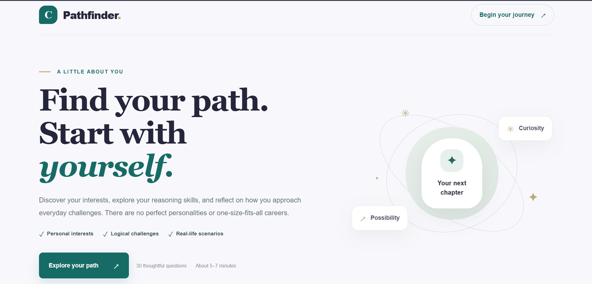
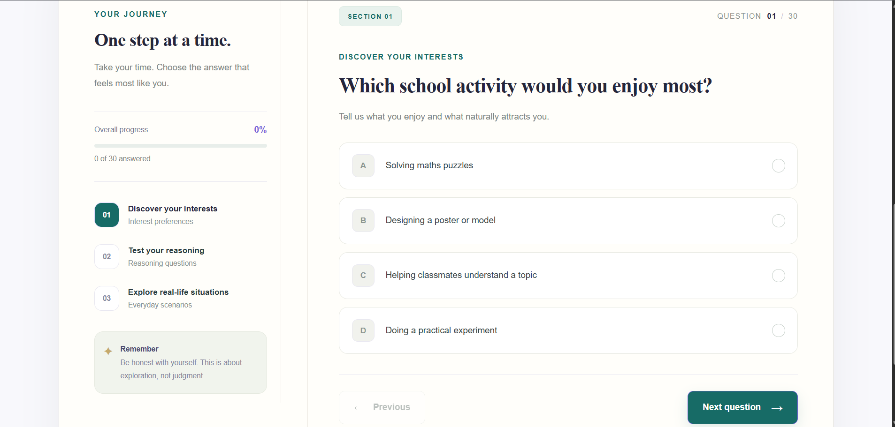

<div align="center">

# 🧭 Pathfinder
### AI-Based Resume Analyser & Career Prediction System

**Discover your interests. Explore your strengths. Find a direction worth pursuing.**

[🌐 **Live Demo — Try Pathfinder**](https://pathfinder-ai-career.vercel.app/)


[](https://react.dev/)
[](https://vite.dev/)
[](https://python.org/)
[](https://catboost.ai/)

</div>

---

## ✨ About Pathfinder

Choosing a career can feel overwhelming—especially when you are still discovering what you enjoy and where your strengths lie.

**Pathfinder** is an AI-based career exploration system designed to help students understand their interests, reflect on their reasoning approach, and explore career directions that may suit them.

It combines a guided, 30-question student profiling journey with a machine-learning component built using the HSLS:09 education dataset. The goal is not to decide a student's future, but to provide a useful starting point for informed exploration.

> **Your future isn't a multiple-choice question. Pathfinder is here to help you explore the possibilities.**

## 🖥️ A look at Pathfinder

### Landing page

The landing page introduces the student journey and its three areas of exploration.



### Student questionnaire

Students move through a guided set of 30 questions, organised into three sections.



### Career results dashboard

After completing the questionnaire, students receive a student career profile with:

- **Career recommendations** and relative exploration match scores.
- **Why explore this career?** explanations showing which questionnaire interest areas contributed to a recommendation.
- **Skills to explore** for each suggested career direction.
- **Beginner project ideas** to help students try out a field.
- **Four-week starter roadmaps** with practical learning steps.

The scores are relative questionnaire-based exploration guides—not probabilities of career success, aptitude measurements, or guarantees of suitability.

## 🚀 How it works

| Stage | What students explore |
|---|---|
| **01 — Discover your interests** | Personal preferences and activities that naturally attract the student. |
| **02 — Test your reasoning** | Logical challenges and reasoning questions. |
| **03 — Explore real-life situations** | Responses to everyday scenarios and practical situations. |

Once the questionnaire is complete, Pathfinder generates a student career profile and presents career directions to explore.

## 🤖 Machine-learning component

Pathfinder also includes a CatBoost classification model that predicts a student's broad **STEM / Non-STEM** career category using the model's configured input features.

### Dataset

Model development used the **High School Longitudinal Study of 2009 (HSLS:09)**, a longitudinal study of students in the United States.

- Original career target: `X1STU30OCC2`
- Prediction task: binary STEM vs Non-STEM classification.
- Gender and race were excluded from the selected model features as a fairness-conscious modelling decision.

### Model comparison

| Model | ROC-AUC | Macro F1 |
|---|---:|---:|
| CatBoost | **0.7248** | **0.6114** |
| Random Forest | 0.6748 | 0.4629 |
| Logistic Regression | 0.6611 | 0.5693 |

CatBoost was selected for the reported model comparison. Its reported PR-AUC was **0.40**, compared with a **0.166** positive-class baseline. Class weighting increased STEM-class recall from 11% to 57% in the reported evaluation.

**Important distinction:** Questionnaire-based career recommendations and the CatBoost STEM/Non-STEM prediction are separate components. Questionnaire recommendation scores should not be interpreted as CatBoost probabilities.

## 🧰 Technology stack

| Area | Technologies |
|---|---|
| Frontend | React, Vite, JavaScript, CSS |
| Backend | Python, Flask |
| Machine learning | CatBoost, scikit-learn, NumPy, pandas |
| Model files | CatBoost `.cbm` model and metadata |
| API communication | HTTP / JSON |

## 📁 Project structure

```text
AI-Based-Resume-Analyser-And-Career-Prediction-System/
├── career-frontend/
│   ├── src/
│   ├── public/
│   ├── package.json
│   └── .env.example
├── career-backend/
│   ├── app.py
│   ├── questionnaire.py
│   ├── binary_stem_catboost.cbm
│   ├── binary_stem_metadata.joblib
│   └── requirements.txt
├── docs/
│   └── screenshots/
├── PROJECT_FINAL_TESTING_REPORT.md
├── POSTMAN_DEMO.md
└── README.md
```

*This highlights the main application files; other project and presentation files may also be present.*

## ⚙️ Run locally

### 1. Clone the repository

```bash
git clone https://github.com/samyak222/AI-Based-Resume-Analyser-And-Career-Prediction-System.git
cd AI-Based-Resume-Analyser-And-Career-Prediction-System
```

### 2. Start the backend

```powershell
cd career-backend
python -m venv venv
.\venv\Scripts\Activate.ps1
pip install -r requirements.txt
python app.py
```

Backend address: `http://127.0.0.1:5000`

### 3. Start the frontend

Open a **second terminal** from the project root:

```powershell
cd career-frontend
npm install
npm run dev
```

Open the local URL printed by Vite (commonly `http://localhost:5173`).

If the frontend uses a configurable backend URL, check `career-frontend/.env.example` and create a local `.env` file with the appropriate value. Never commit `.env` files or credentials.

## 🔌 Backend API

| Method | Endpoint | Purpose |
|---|---|---|
| `GET` | `/health` | Backend health check |
| `GET` | `/features` | Inspect configured model features |
| `POST` | `/predict` | Run the STEM / Non-STEM model prediction |
| `GET` | `/questionnaire` | Retrieve the student questionnaire |
| `POST` | `/profile` | Generate the questionnaire-based student profile and career recommendations |

For request examples, see [`POSTMAN_DEMO.md`](POSTMAN_DEMO.md).

## 🎯 Project scope & transparency

Pathfinder is a **career exploration and recommendation prototype**, not a professional psychometric assessment or a guaranteed career prediction tool.

- Questionnaire recommendations are based on the implemented interest/scenario scoring logic.
- CatBoost produces a separate STEM/Non-STEM prediction using its configured model inputs.
- Relative exploration scores are not probabilities.
- Automated resume parsing and full resume-to-job matching are not represented as implemented features in this version.
- The system should support reflection and exploration—not replace a student's own judgement, teachers, counsellors, or career guidance.

## 🔮 Future enhancements

- Resume upload and structured resume parsing.
- Skill-gap analysis and course recommendations.
- Expanded career pathways beyond the current recommendation set.
- More extensive model validation and fairness evaluation.
- Student progress tracking and saved career exploration profiles.

## 👥 The team

Built as a B.Tech minor project at **Jaypee University of Engineering and Technology (JUET), Guna**.

---

<div align="center">

### 🌱 Every great journey starts with a first step.

**Find your path. Start with yourself.**

</div>
